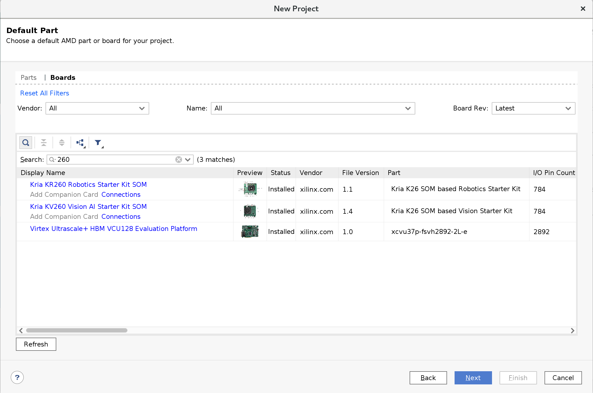
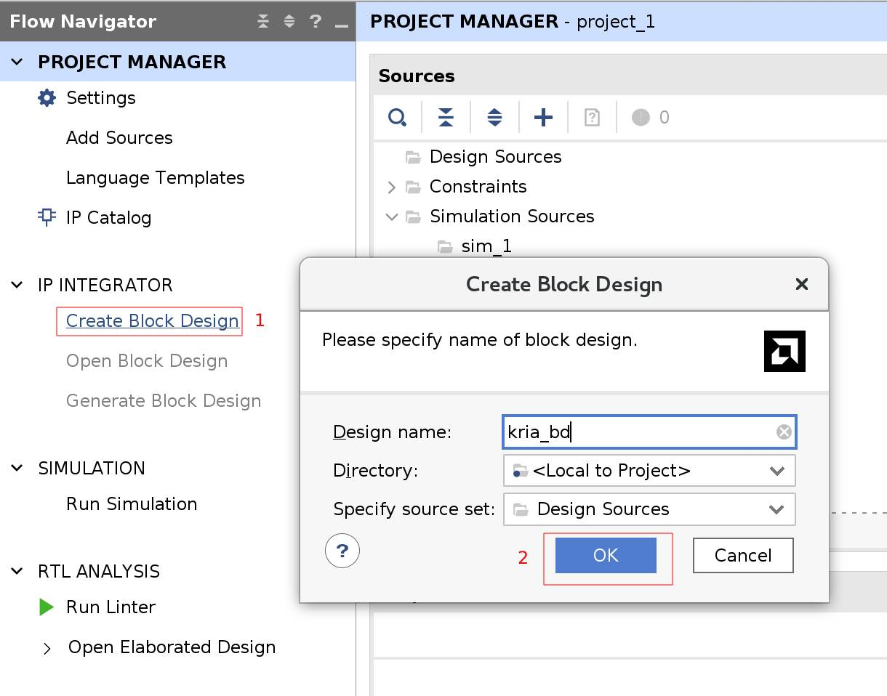
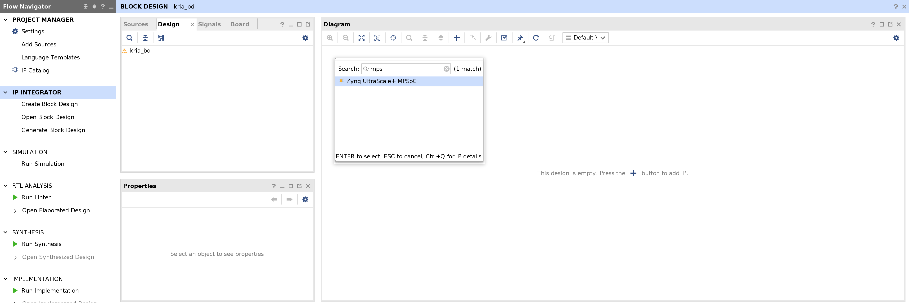
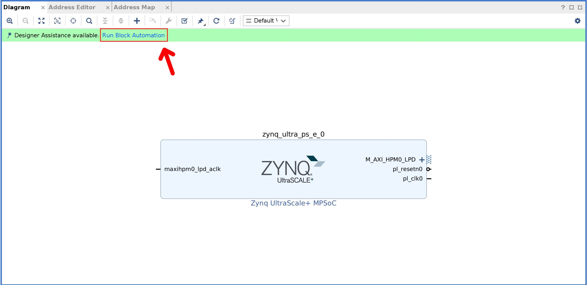
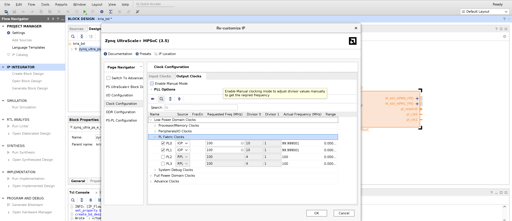
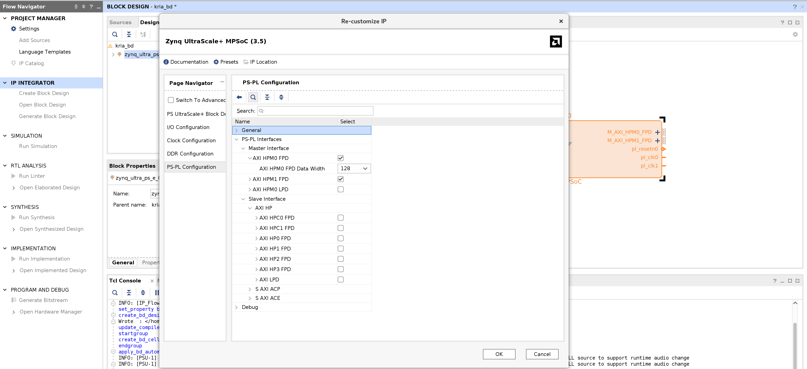

# Kria Boards

---

### Guide to using Kria KV260 and KR260

This guide focuses on using the PL (FPGA) resources, so the PS (ARM CPU) is shown only as a secondary topic.


## Table of Contents

---

- [Kria Boards](#kria-boards)
    - [Guide to using Kria KV260 and KR260](#guide-to-using-kria-kv260-and-kr260)
  - [Table of Contents](#table-of-contents)
  - [Feature overview](#feature-overview)
    - [PS Features](#ps-features)
    - [PL Features](#pl-features)
  - [Zynq UltraScale+ MPSoC](#zynq-ultrascale-mpsoc)
    - [PL Clock](#pl-clock)
    - [AXI S/M](#axi-sm)
    - [Using the UART](#using-the-uart)
    - [DDR4](#ddr4)
  - [Instantiating the block design wrapper](#instantiating-the-block-design-wrapper)
  - [Programming the board](#programming-the-board)
    - [JTAG Programming via XSDB](#jtag-programming-via-xsdb)
    - [Alternative Programming Methods](#alternative-programming-methods)
  - [Differences between the KV and KR boards](#differences-between-the-kv-and-kr-boards)
    - [Carrier Card Comparison](#carrier-card-comparison)
    - [Key Differences for PL Developers](#key-differences-for-pl-developers)

---

## Feature overview

---

Both boards use the [K26 SoM](https://www.amd.com/en/products/system-on-modules/kria/k26.html), which incorporates a quad-core ARM CPU with a large FPGA area. The CPU part is going to be called PS in this guide, and the FPGA part is going to be called PL.

### PS Features

| Component / Subsystem | Specification | Description |
| :--- | :--- | :--- |
| **Application Processing Unit (APU)** | Quad-core Arm® Cortex®-A53 MPCore™ | Up to 1.33 GHz, 32 KB L1 instruction and data caches per core, 1 MB L2 cache with ECC, Armv8-A (64-bit), NEON™ SIMD, VFP4, cryptography extensions |
| **Real-Time Processing Unit (RPU)** | Dual-core Arm® Cortex®-R5F MPCore™ | Up to 533 MHz, 32 KB L1 instruction and data caches per core, 128 KB TCM per core with ECC, Armv7-R (32-bit), FPU, Split and Lock-step modes |
| **Graphics Processing Unit (GPU)** | Arm® Mali™-400 MP2 | Up to 600 MHz, 64 KB L2 cache, 2D/3D graphics acceleration, OpenGL ES 1.1 / 2.0, OpenVG 1.1 |
| **Dynamic Memory Controller (DDRC)** | 4 GB 64-bit wide DDR4 | 2400 Mb/s (non-ECC), multi-port controller with configurable Quality of Service (QoS) |
| **Non-Volatile Storage (On-SOM)** | 512 Mb QSPI Flash<br>16 GB eMMC (v5.1)<br>64 Kb I2C EEPROM | Dual parallel QSPI for primary boot/firmware<br>Non-volatile storage for OS and application data<br>Carrier/SOM identification and configuration data |
| **Platform Management Unit (PMU)** | Dedicated MicroBlaze™ core | Power sequencing, system reset, safety/tamper monitoring, and sleep mode control |
| **Configuration Security Unit (CSU)** | Hardware Cryptographic Acceleration | Secure boot, tamper monitoring, AES-GCM-256, SHA-3/384, RSA-4096 |
| **System Monitor (SysMon)** | Dual 10-bit 1 MSPS ADCs | On-chip voltage and temperature monitoring with programmable threshold alarms |
| **Real-Time Clock (RTC)** | Battery-backed Real-Time Clock | Accurate timekeeping with external battery pin via carrier card connector |
| **High-Speed Serial I/O (PS-GTR)** | 4 transceivers (up to 6.0 Gb/s) | Supports PCIe Gen2 ×4, USB 3.0, DisplayPort 1.2a, and SATA 3.0 |
| **Multiplexed I/O (MIO) & Peripherals** | 3 Banks (500, 501, 502) at 1.8V | 2× Gigabit Ethernet, 2× USB 2.0/3.0, 2× SD/SDIO, 2× SPI, 2× CAN/CAN-FD, 2× I2C, 2× UART |
| **Security Module** | TPM 2.0 (SLB 9670) | Dedicated security chip for trusted boot and cryptographic hardware identification |

### PL Features

| Resource | Quantity | Description |
| :--- | :--- | :--- |
| **System Logic Cells** | 256,200 | Programmable logic cells |
| **CLB Flip-Flops** | 234,240 | Configurable Logic Block (CLB): Total number of flip-flops |
| **CLB LUTs** | 117,120 | Configurable Logic Block (CLB): Total number of 6-input look-up tables |
| **Distributed RAM** | 3.5 Mb | Distributed RAM memory footprint within CLBs |
| **Block RAM Blocks** | 144 | Number of 36 Kb Block RAMs (true dual-port, also configurable as 2× 18 Kb) |
| **Block RAM Capacity** | 5.1 Mb | Total Block RAM memory footprint |
| **UltraRAM Blocks** | 64 | Dual-port 288 Kb high-density memory blocks (72-bit wide with ECC) |
| **UltraRAM Capacity** | 18.0 Mb | Total UltraRAM memory footprint (64 × 288 Kb) |
| **DSP Slices** | 1,248 | DSP48E2 slices (27 × 18 signed multiplier with 48-bit accumulator) |
| **Clock Management Tiles (CMTs)** | 4 | Mixed-Mode Clock Managers (MMCMs) and Phase-Locked Loops (PLLs) |
| **Video Codec Unit (VCU)** | 1 | Simultaneous H.264 / H.265 (AVC/HEVC) multi-standard codec (up to 4Kp60) |
| **High-Density I/O (HDIO)** | 69 | High-density digital I/O pins (supports 1.2V to 3.3V rails) |
| **High-Performance I/O (HPIO)** | 116 | High-performance differential I/O pairs (supports 1.0V to 1.8V rails) |
| **GTH Transceivers** | 4 | Multi-gigabit serial transceivers operating up to 12.5 Gb/s |
| **Transceiver Fractional PLLs** | 8 | Specialized PLLs for high-speed serial communication transceivers |
| **PCI Express (PL)** | 1 | Integrated PCIe block supporting Gen2 configurations |

---

## Zynq UltraScale+ MPSoC

Vivado has an IP specific to the K26 SoM, called Zynq UltraScale+ MPSoC. To enable it, you have to select one of the boards as the *Default Part* in the Vivado project manager as shown in the image.


Once you have selected one of the boards as the Default Part, you can add the IP for the Zynq UltraScale+ MPSoC. I prefer to use a block design to make it easier to configure and connect other parts. The complete initial step-by-step is shown in the images below.





It is recommended that you use the Run Block Automation option to apply the board preset; this makes the next configuration easier.



### PL Clock

The PS is responsible for providing the PL with its clock. You can select the frequency and source for the clock using the IP re-customization tool. If you need a very specific clock, you can use the manual mode to be able to choose the divisors for your clock, making it easier to get to the required frequency.


### AXI S/M

The SoM contains multiple AXI ports to enable PS-PL communication. You can use them to do things like connecting the 4 GB DDR4 memory present in the SoM to the PL. You can also use them to leverage the PL as a hardware accelerator, but this is outside the scope of this guide.



### Using the UART

Both boards have a micro-USB connector connected to a quad-channel FTDI chip. The `ttyUSB0` port is connected directly to the PL, and `ttyUSB1` is the default terminal connection for the PS. By enabling both of them and running a simple redirect program on the PS, we can communicate with the PL using only the micro-USB cable. I'm working on an in-depth tutorial explaining how to do it.

### DDR4

As discussed before, we can use the AXI interfaces to let the PL access the 4 GB DDR4 memory that resides inside the SoM. I'm currently working on a new tutorial covering this topic in depth. In the meantime, refer to the official [AMD Zynq UltraScale+ Device Technical Reference Manual (UG1085)](https://docs.amd.com/r/en-US/ug1085-zynq-ultrascale-trm) for memory controller and AXI port details.

---

## Instantiating the block design wrapper

---

Once you have your complete block design, follow these steps to add it to your project:

1. Right-click the block design (`.bd`) inside *Sources* and select **Generate Output Products...**.
2. Right-click it again and select **Create HDL Wrapper...**.

When prompted, choose one of the two options:
- **Let Vivado manage wrapper and auto-update** (recommended): Vivado will automatically update the wrapper whenever the block design changes.
- **Copy generated wrapper to allow user edits**: Allows manual modifications to the wrapper file, but you must keep it in sync with future block design edits yourself.

With the HDL wrapper created, you can use it in your design in two ways:

- **As the Top-Level Module**: If all your external ports (clocks, resets, I/O pins) are directly routed through the block design, right-click the generated wrapper file in *Sources* and select **Set as Top**.
- **Instantiating inside Custom RTL**: If you have custom PL logic written in Verilog, SystemVerilog, or VHDL, you can instantiate the wrapper module directly in your top-level RTL file. Open the generated wrapper file to inspect its port declaration, then connect the wrapper's ports—such as the fabric clock (`pl_clk0`), reset, AXI interfaces, and externalized signals—to your custom logic and the pin constraints (`.xdc`).

For more details on managing IP integrator subsystems and wrappers, see the [Vivado Design Suite User Guide: Designing IP Subsystems Using IP Integrator (UG994)](https://docs.amd.com/r/en-US/ug994-vivado-ip-subsystems).

---

## Programming the board

Use the script available [here](boot.tcl). It connects to the board, changes the boot mode to JTAG, targets and initializes the PSU using the configuration file, then targets the PL/FPGA and loads the bitstream generated by Vivado.

### JTAG Programming via XSDB

By default, the Kria starter kits boot from on-board QSPI flash. When working primarily with the PL or running baremetal designs over JTAG, you can override the boot mode register dynamically using XSDB (Xilinx System Debugger) without needing physical jumper changes.

Here is the `boot.tcl` script:

```tcl
# AMD Kria KV260 / KR260 JTAG Programming & Initialization Script
# For use with XSDB (Xilinx System Debugger) / XSCT

# 1. Connect to the hardware server
connect

# 2. Target the PSU and switch boot mode to JTAG
# Overrides default QSPI boot mode dynamically via BOOT_MODE_USER register (0xFF5E0200)
targets -set -nocase -filter {name =~ "*PSU*"}
# Clear multiboot register
mwr 0xffca0010 0x0
# Force JTAG boot mode (0x0100 sets use_alt bit and selects JTAG)
mwr 0xff5e0200 0x0100
# Perform system reset to apply boot mode
rst -system
after 2000

# 3. Target the PSU again after reset
targets -set -nocase -filter {name =~ "*PSU*"}

# 4. Program the PL (FPGA bitstream generated by Vivado)
# Update the bitstream path as needed:
fpga -file design_1_wrapper.bit

# 5. Initialize the Processing System (PS)
# Source the psu_init.tcl generated by Vivado hardware export (XSA)
source psu_init.tcl
psu_init
psu_ps_pl_isolation_removal
psu_ps_pl_reset_config

puts "Kria board PL programming and PS initialization complete."
```

To run the script:
1. Connect your Kria board to your host PC using the micro-USB cable and power it on.
2. Ensure `design_1_wrapper.bit` and `psu_init.tcl` (exported from Vivado via **File > Export > Export Hardware**) are in your working directory.
3. Launch XSDB and execute the script:
   ```bash
   xsdb boot.tcl
   ```

### Alternative Programming Methods

- **Vivado Hardware Manager**: You can open the Hardware Manager in Vivado, click **Open Target** > **Auto Connect**, and select **Program Device**. Note that if your PL design depends on clocks generated by the PS (`pl_clk0`), the PS must be initialized (via the script above or running boot firmware) for the PL clock to become active.
- **Linux FPGA Manager (`xmutil`)**: If you are running Linux on the board, AMD provides the `xmutil` utility to dynamically load bitstreams and device tree overlays at runtime without rebooting:
  ```bash
  sudo xmutil unloadapp
  sudo xmutil loadapp <app_name>
  ```

For more details, see the official [Vivado Design Suite User Guide: Programming and Debugging (UG908)](https://docs.amd.com/r/en-US/ug908-vivado-programming-debugging) and the [Vitis Embedded Development Guide (UG1400)](https://docs.amd.com/r/en-US/ug1400-vitis-embedded).

---

## Differences between the KV and KR boards


Both boards use the same [Kria K26 SOM](https://www.amd.com/en/products/system-on-modules/kria/k26.html), sharing identical core processing and logic capabilities (quad-core Arm Cortex-A53, dual-core Cortex-R5F, 256K logic cells, and 4 GB 64-bit DDR4). However, their carrier cards differ significantly depending on the target application:

- **Kria KV260 Vision AI Starter Kit**: Designed primarily for smart city, video analytics, and machine vision applications.
- **Kria KR260 Robotics Starter Kit**: Designed for robotics, industrial automation, and real-time deterministic communication.

### Carrier Card Comparison

| Feature / Subsystem | Kria KV260 Vision AI Starter Kit | Kria KR260 Robotics Starter Kit |
| :--- | :--- | :--- |
| **Primary Target** | Vision AI, smart cameras, video analytics | Robotics, industrial automation, real-time control |
| **SOM Connectors** | 1× 240-pin connector (`SOM240_1`) | 2× 240-pin connectors (`SOM240_1` and `SOM240_2`) |
| **Networking** | 1× Gigabit Ethernet RJ45 (PS-GEM3), 1× SFP+ cage (GigE Vision) | 4× Gigabit Ethernet RJ45 (2× PS GEMs, 2× PL-based with TSN support), 1× SFP+ cage (10GigE Vision) |
| **Camera & Sensor Inputs** | 2× Onsemi IAS interfaces (built-in AP1302 ISP), 1× Raspberry Pi Camera header | 1× SLVS-EC high-speed camera interface (industrial sensors) |
| **Video Outputs** | 1× HDMI 1.4, 1× DisplayPort 1.2a | 1× DisplayPort 1.2a |
| **Expansion Headers** | 1× 12-pin Pmod header (J2) | 4× 12-pin Pmod headers (Pmod 1 to 4, 3.3V), 1× 40-pin Raspberry Pi HAT header |
| **Industrial Interfaces** | None | 1× CAN 2.0B interface (PS-based), 1× RS-485 interface (PS-based) |
| **USB Connectivity** | 4× USB 3.0 / 2.0 Type-A, 1× micro-USB (JTAG/UART via FTDI) | 4× USB 3.0 Type-A, 1× micro-USB (JTAG/UART via FTDI) |
| **Power Input** | 12V DC barrel jack (3A) | 12V DC barrel jack (3A or 4A) |

### Key Differences for PL Developers

- **Available PL Pins**: The KV260 carrier card connects to only one 240-pin connector (`SOM240_1`), leaving many PL pins inaccessible. The KR260 connects to both 240-pin connectors (`SOM240_1` and `SOM240_2`), giving access to four Pmod headers and the 40-pin Raspberry Pi HAT expansion header.
- **Industrial Communication**: The KR260 includes hardware transceivers for industrial fieldbuses (CAN 2.0B and RS-485) and four Ethernet ports with Time-Sensitive Networking (TSN) support, which are not present on the KV260.
- **Vision Hardware**: The KV260 integrates dedicated camera hardware, including Onsemi IAS connectors with an on-board AP1302 ISP and an HDMI 1.4 output, making it better suited for direct camera sensor interfacing and video display.

For further details, refer to the official documentation:

- [Kria KV260 Vision AI Starter Kit User Guide (UG1089)](https://docs.amd.com/r/en-US/ug1089-kv260-starter-kit)
- [Kria KR260 Robotics Starter Kit User Guide (UG1092)](https://docs.amd.com/r/en-US/ug1092-kr260-starter-kit)
- [Kria KV260 Starter Kit Data Sheet (DS986)](https://docs.amd.com/v/u/en-US/ds986-kv260-starter-kit)
- [Kria KR260 Starter Kit Data Sheet (DS988)](https://docs.amd.com/v/u/en-US/ds988-kr260-data-sheet)
- [Kria K26 SOM Data Sheet (DS987)](https://docs.amd.com/v/u/en-US/ds987-k26-som)

---
